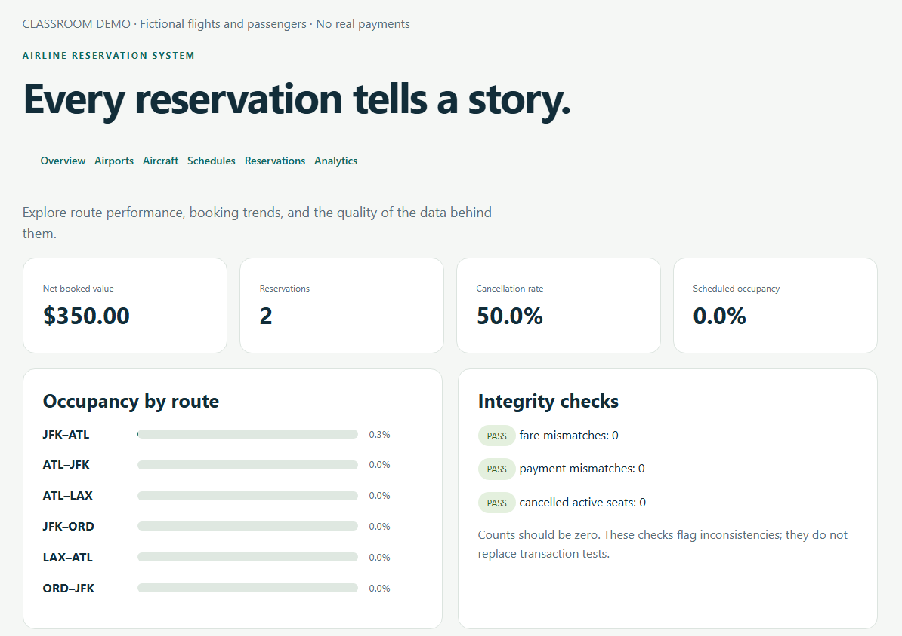
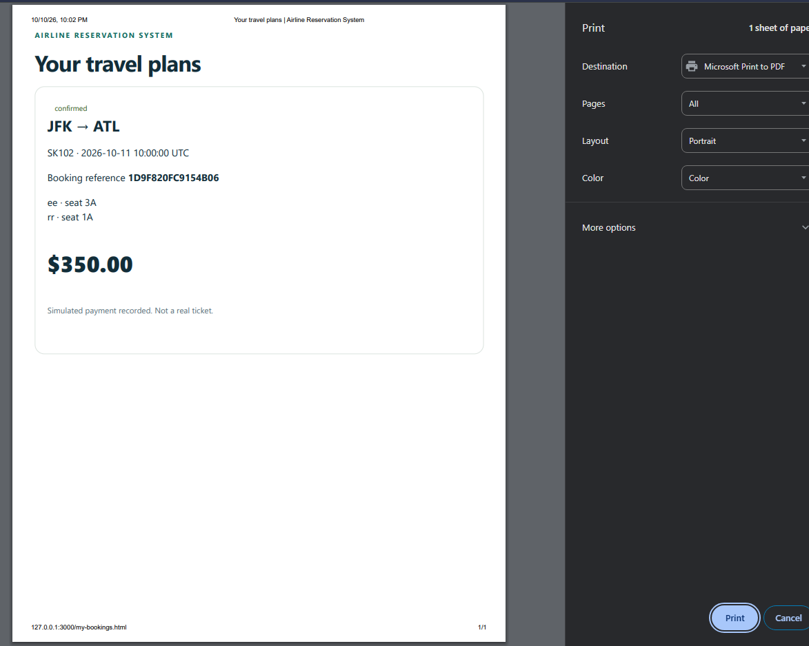

# Airline Reservation System

A Node.js and MySQL application for searching flights, booking seats and cancelling reservations. The admin dashboard includes SQL reports for booking trends, seat occupancy, cancellations and simulated booking value.

Project by **JahMari Harrigan**, developed with Codex assistance.

## Features
- Relational modeling, primary/foreign/alternate keys, normalization and MySQL constraints.
- Atomic multi-passenger bookings, concurrency control and historical seat-allocation records.
- Customer authentication, database-backed sessions, CSRF protection and administrator authorization.
- SQL joins, CTEs, window functions, data-quality checks, metric definitions and CSV reporting.
- Genuine alpha and beta Git milestones, automated integration tests and reproducible setup.

This is a classroom system. All flights, passenger names and payments are simulated. It does not issue real tickets or process money.

## How to run
Prerequisites: Node.js 22 or newer, npm, and MySQL 8.4. The project was checked with Node.js 24 and MySQL 8.4.7 on Windows.

1. Create a new empty MySQL database and a project account. Run these statements as your MySQL administrator, saving the generated password locally for your .env file:
```sql
CREATE DATABASE skyline_air CHARACTER SET utf8mb4 COLLATE utf8mb4_0900_ai_ci;
CREATE USER 'skyline'@'localhost' IDENTIFIED BY RANDOM PASSWORD;
GRANT ALL PRIVILEGES ON skyline_air.* TO 'skyline'@'localhost';
```
The setup account needs schema permissions. For a hosted deployment, use a separate migration account and restrict the runtime account to necessary data operations.

2. Copy `.env.example` to `.env`. Set database credentials and a demo password of at least 12 characters. Never commit `.env`.
3. Run from the project directory:
```text
npm ci
npm run setup
npm start
```
4. Open `http://127.0.0.1:3000`. Use `customer@example.test` or `admin@example.test`, with your configured `DEMO_PASSWORD`. You can also register a new fictional customer. Administrators are provisioned by setup, not public registration.

Run setup **once on a fresh database**. It intentionally refuses existing tables rather than destroying your bookings. It creates four airports, two 24-seat aircraft, six flight definitions and 180 departures over the next 30 days. Each booking contains one dated departure and one to four passengers. Times are explicitly UTC. Fares use integer cents.

## Optional analytics scenario
On a fresh seeded demo database, before creating interactive reservations:
```text
node --env-file=.env scripts/seed-analytics.js
```
This inserts 660 fictional reservations. The generated scenario has 528 confirmed bookings, 132 cancellations and $105,080 in net booked value. These are designed test data, not evidence of real demand or business impact. The script refuses repeated execution. Read [metric definitions](analytics/METRICS.md), run [analysis queries](analytics/analysis.sql), and open the administrator Analytics page.

## Tests
Use a disposable classroom database created by setup. Do not run tests against real customer records.
```text
npm test
node --env-file=.env scripts/persistence-check.js
```
The suite creates and removes its own fictional test records. Evidence is saved in `evidence/`. It covers invalid inputs, search, price integrity, multi-passenger rollback, concurrent seat allocation, cancellation, ownership, administrator permissions, catalog changes, full capacity and departure cancellation. A separate check restarts the Node.js server and verifies persistence. Windows sandbox limitations and any incomplete manual checks are listed in the reports.

## Architecture
```text
public/*.html + public/app.js + public/styles.css
                 | fetch JSON /api
src/server.js -> src/admin.js -> src/db.js -> MySQL
                 | transactions and database constraints
analytics/analysis.sql -> dashboard + route CSV
```
`schema.sql` is the canonical schema; `seed.sql` is synthetic reference data. `scripts/setup.js` adds password hashes, seats and dated departures. HTML pages are individually supplied as required by the rubric.

Booking creation locks the dated departure, derives price on the server, and inserts booking, passengers, allocations and a simulated payment in one transaction. A unique `(instance_id, active_seat)` key enforces active inventory. Cancellation releases allocations while retaining history and voids the simulated payment. Composite foreign keys ensure an allocation belongs to both the booking's departure and its aircraft.

## Versions
| Tag | Scope | Evidence |
|---|---|---|
| alpha | Customer search and persistent transactional booking | 9 passing tests |
| beta | Administrator maintenance, protected fare history, route analytics | 13 passing tests |
| production | Classroom release with synthetic analysis, authentication throttling, expanded tests and reports | See final evidence and outstanding checklist |

The commits were created during actual successive implementation stages. They are not backdated. Codex assistance is recorded in `DEVELOPMENT_LOG.md`.

## Course submission status
The course reports and PDF video guide are in `docs/`. The guided owner walkthrough and a genuine CLI print refinement are recorded in the evaluation report and evidence/cli-print-review.md. Three participant evaluations are recorded from owner-supplied feedback and ratings; tested versions and their relationship to the development timeline still need reconciliation. The student's presentation remains incomplete. Narrow-window and keyboard checks were owner-reported; actual mobile-device and assistive-technology checks remain unverified. Blank participant forms are not results. Resume revisions were prepared separately; final submission files and links still need checking. See `SUBMISSION_CHECKLIST.md` before submission.

## Limits and next steps
One-way, single-segment economy bookings; no layovers, hotels, cars, discounts or real payment provider. Aircraft seat layouts are fixed after creation. Existing flight definitions with dated departures cannot change routes; cancel and create a replacement schedule instead. Fares can change for new bookings. No password reset, email delivery, audit trail or multi-server rate-limit store. The administrator list shows the latest 300 departures/reservations; the customer list shows all owned bookings. HTTPS and secure cookies are required for hosted use (`NODE_ENV=production`).

This repository contains the application source, reports and test evidence. To try the application, follow the local setup instructions above. The course presentation link is included only in the submission ZIP.

The original `alpha`, `beta` and `production` versions are available as GitHub tags. A backup of their history is also preserved in `history/Skyline-Air-History.bundle`.


The project was renamed from Skyline Air to Airline Reservation System. Historical commits, evidence logs, and the original history bundle retain their original names. Existing database and session identifiers are retained for compatibility.

## Browser evidence

Owner walkthrough, October 10, 2026. Fictional booking data.




